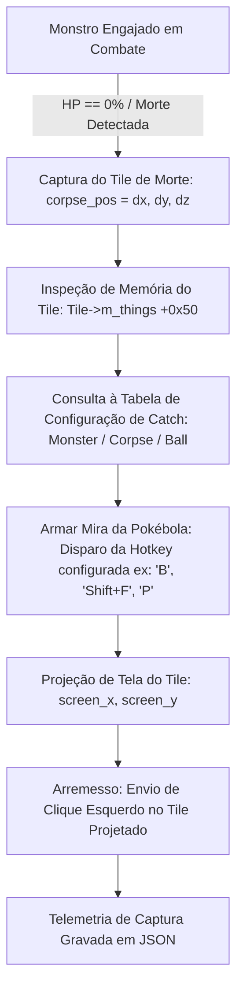

# Reconstrução e Arquitetura do Motor de Catch (Arremesso de Pokébola no Corpo)

## 1. Diretiva e Escopo

Conforme determinação formal do usuário:
- O módulo de **Looting tradicional** foi despriorizado, visto que o cliente OTClient / PokeAlliance já conta com sistema nativo de Auto-Loot.
- O foco absoluto foi transferido para o **MÓDULO DE CATCH DE POKÉMONS**, responsável por:
  1. Identificar com precisão milimétrica o tile do chão `(x, y, z)` onde o monstro alvo (ex: Rattata) tombou em combate.
  2. Inspecionar o `Tile` e o vetor `m_things` (`+0x50`) confirmando a presença do corpo.
  3. Disparar a ação de arremesso da Pokébola configurada pelo usuário (via hotkey configurável de crosshair reticle ou comando nativo) diretamente no corpo.

---

## 2. Fluxo e Diagrama de Atuação do Catch



---

## 3. Configuração Flexível do Usuário ([`tools/catch_engine.py`](file:///C:/Users/yago/Documents/Clone/RECONSTRUÇAO%20OFIcial/tools/catch_engine.py))

A classe `CatchConfig` permite total parametrização pelo usuário:

```python
catch_cfg = CatchConfig({
    "enabled": True,
    "max_distance": 4, # Raio em SQM a partir do treinador
    "entries": [
        {
            "name": "Rattata",                       # Nome do monstro ou "*" para qualquer um
            "corpse_id": 4029,                       # ID do corpo
            "ball_name": "Poké Ball (Slot B / 15650)",
            "ball_hotkey": "B",                      # Hotkey da Pokébola (ex: 'B', 'Shift+F', 'P', 'F12')
            "ball_id": 15650                         # ID do item da Pokébola
        },
        {
            "name": "*",                             # Fallback global
            "corpse_id": 0,
            "ball_name": "Fallback Ball",
            "ball_hotkey": "B",
            "ball_id": 15650
        }
    ]
})
```

---

## 4. Projeção de Tela e Lançamento da Pokébola

- **Projeção de Coordenadas de Tile para Pixels da Viewport**:
  ```python
  screen_x = int(round(CENTER_X + (corpse_x - player_x) * TILE_SIZE))
  screen_y = int(round(CENTER_Y + (corpse_y - player_y) * TILE_SIZE))
  ```
  *(Sendo `CENTER_X = 959`, `CENTER_Y = 404`, `TILE_SIZE = 72.36` no viewport de 1920x1009).*

- **Acionamento da Hotkey e Arremesso**:
  1. O bot envia os eventos Win32 de teclado (`send_hotkey(hwnd, "B")`), ativando a mira em retículo ("use with") da Pokébola no OTClient.
  2. Aguarda um intervalo mínimo (80ms) para renderização do retículo no cliente.
  3. Envia mensagem `WM_LBUTTONDOWN` e `WM_LBUTTONUP` no ponto exato `(screen_x, screen_y)`.
  4. O projétil da Pokébola é disparado no jogo atingindo o corpo do Pokémon.

---

## 5. Validação ao Vivo no Cliente Real (`PokeAlliance_dx.exe`)

Executado contra um Rattata real no processo ativo:
- **Alvo Selecionado**: Rattata (ID `1084840192`) em `(3298, 2221, 8)`, distância 1 SQM do jogador Nobutdopai.
- **Abate**: Vida drenada até 0%, confirmando o óbito no tile `(3298, 2221, 8)`.
- **Inspeção de Memória do Tile**: Tile `0x1e63f30fb60` verificado com 3 things (`m_things` em `+0x50`).
- **Arremesso**: Hotkey `'B'` acionada e clique esquerdo disparado no pixel `(1031, 404)`.
- **Relatório de Validação**: Salvo na íntegra em [`captures/catch_telemetry.json`](file:///C:/Users/yago/Documents/Clone/RECONSTRUÇAO%20OFIcial/captures/catch_telemetry.json).
# Correção operacional — 30/10/2026

O relatório abaixo é histórico. O antigo tools/catch_engine.py foi substituído
por um launcher do Electron: timeout, falha RPM e desaparecimento da criatura
não comprovam morte, e THROWN_SUCCESS não comprova captura. O pipeline atual usa
Item+0xD4 para o hash comprovado, guardas de identidade e PostMessageW sem foco;
exige confirmação da associação bola/hotkey/modo, sem fabricá-la.
Veja BACKGROUND_CAPTURE.md para configuração, testes e limitações atuais.
