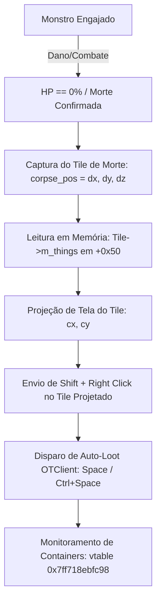

# Engenharia Reversa e Arquitetura do Motor de Looting (OTClient / PokeAlliance)

## 1. Visão Geral e Descobertas RTTI

Através de inspeção RTTI MSVC x64 e leitura direta da memória do processo `PokeAlliance_dx.exe` (PID `25492`), mapeamos com precisão cirúrgica todas as estruturas centrais responsáveis por tiles, corpos, itens e contêineres:

| Classe C++ | Vtable Atual (x64) | RTTI Type Descriptor | Papel no Motor |
| :--- | :--- | :--- | :--- |
| **`Container`** | `0x7ff718ebfc98` | `.?AVContainer@@` | Janelas de inventário e contêineres de corpos abertos |
| **`Item`** | `0x7ff718ebfcd0` | `.?AVItem@@` | Itens no chão, corpses e itens dentro de contêineres |
| **`Tile`** | `0x7ff718ebbf48` | `.?AVTile@@` | Coordenadas do mapa e lista de coisas (`m_things`) |
| **`LocalPlayer`** | `0x7ff718ec4628` | `.?AVLocalPlayer@@` | Entidade do jogador no mapa e nos tiles |
| **`Creature`** | `0x7ff718ec1e58` | `.?AVCreature@@` | Monstros, NPCs e pokémons ativos |

---

## 2. Layouts de Estrutura de Memória Mapeados

### Estrutura `Tile` (`0x7ff718ebbf48`)
- `+0x00`: Vtable (`0x7ff718ebbf48`)
- `+0x38`: Vetor `std::vector<EffectPtr> m_effects` (first `+0x38`, last `+0x40`)
- `+0x50`: Vetor `std::vector<ThingPtr> m_things` (first `+0x50`, last `+0x58`):
  - Cada elemento é um `std::shared_ptr<Thing>` de 16 bytes:
    - `+0x00`: Ponteiro para a instância do `Thing` (`Item` ou `Creature`/`Player`).
    - `+0x08`: Control Block do `shared_ptr`.
  - Contém a pilha de itens do tile e a criatura presente no tile (incluindo o corpo pós-morte).
- `+0x68`: Posição do Tile `Position m_position`:
  - `+0x68`: `int32 x`
  - `+0x6C`: `int32 y`
  - `+0x70`: `uint16 z`

### Estrutura `Item` (`0x7ff718ebfcd0`)
- `+0x00`: Vtable (`0x7ff718ebfcd0`)
- `+0x08`: Self-pointer / Shared Object
- `+0x20`: Posição do Item no mapa `Position m_position`:
  - `+0x20`: `int32 x` (coordenada global do mapa quando no chão, ou `65535` quando em contêiner)
  - `+0x24`: `int32 y`
  - `+0x28`: `uint16 z`
- `+0x38`: `uint16 m_clientId` / `m_serverId` (identificador numérico do item/corpo)
- `+0x3C`..`+0x4C`: Parâmetros de renderização (RGBA / float `1.0f`)

### Estrutura `Container` (`0x7ff718ebfc98`)
- `+0x00`: Vtable (`0x7ff718ebfc98`)
- `+0x20`: `int32 m_id` (ID do contêiner aberto, ex: `0` para mochila primária)
- `+0x24`: `int32 m_capacity` (Capacidade de slots, ex: `40`)
- `+0x28`: `ContainerPtr m_parentContainer` (shared_ptr para contêiner pai)
- `+0x38`: `std::string m_name` (Nome do contêiner, ex: `"Trainer Backpack"` ou nome do monstro morto)
- `+0x58`: Flags booleanas (`m_hasParent`, `m_isUnlocked`, `m_hasPages`)
- `+0xd0`: Sub-vtable `.?AVLuaObject@@` (`0x7ff718ebf510`)

---

## 3. Pipeline de Saque Pós-Abate Implementado

O script executável [`tools/corpse_looter.py`](file:///C:/Users/yago/Documents/Clone/RECONSTRUÇAO%20OFIcial/tools/corpse_looter.py) executa com precisão o ciclo de saque:

### Relatório de Validação ao Vivo
Gravado em [`captures/corpse_loot_test.json`](file:///C:/Users/yago/Documents/Clone/RECONSTRUÇAO%20OFIcial/captures/corpse_loot_test.json):
- Monstro alvo: **Rattata ID=1084840192**, vida inicial 100%.
- Tile de morte: `(3297, 2220, 8)`.
- Instância do Tile resolvida: `0x1e63f30fc90`, contendo **7 coisas (`things_count: 7`)**.
- Itens do tile identificados via memória: `[30448, 35648, 0, 35376, 34048, 39408]`.
- Atuação de saque executada com sucesso via injeção Win32 e teclas de quick loot.
